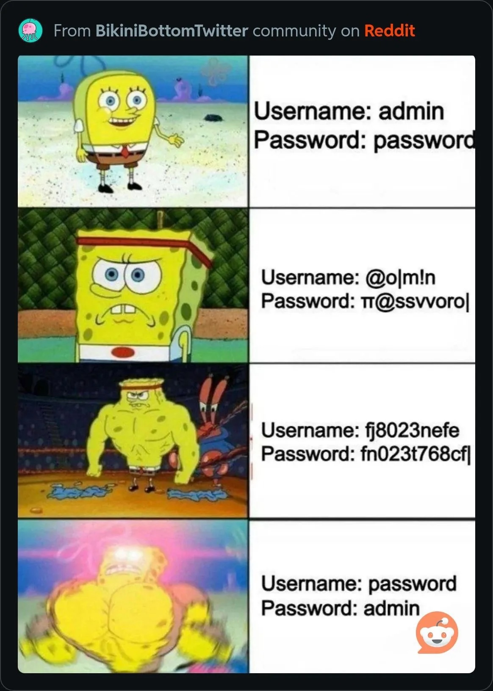

Each semester in my Security class, I give a month-long lab to crack as many passwords as possible.  For this fall's contest (opened on October 8th), I used two different hash types: MD5 and SHA-512.  The contest closed on October 30th at 11:59 PM Pacific.  The password hashes (16 total):

<pre>
sisterbear:$1$XRub7jM3$PbPrTbDihmbvW7rPDUZqn/:1001:1001:,,,:/home/sisterbear:/bin/bash
grizzlybear:$1$PvdZwfFc$an2eYa.WX0kZonUuE7gO6.:1002:1002:,,,:/home/grizzlybear:/bin/bash
jackbear:$1$USPPxCIF$ozJIti0iWbmiUOAGxCw3I/:1003:1003:,,,:/home/jackbear:/bin/bash
pandabear:$1$hqlSNWAg$9rHaTHqOIhNQZ3DNBRtfu.:1004:104:,,,:/home/pandabear:/bin/bash
yogibear:$1$hSC0V30g$O.62m.1Dzix3.8PImLmdd1:1005:1005:,,,:/home/yogibear:/bin/bash
mamabear:$1$m8KgJkZH$V7L.swdMXDm6QLgRBx0.Y0:1006:1006:,,,:/home/mamabear:/bin/bash
barneybear:$1$wS8tdtBc$f3TxmTF40KFaqZOinHHeQ0:1007:1007:,,,:/home/barneybear:/bin/bash
papabear:$1$Al9bu5eA$1LbMzSMVlxWgPiXKL4N.V1:1008:1008:,,,:/home/papabear:/bin/bash
bluebear:$6$moqkkF4KgucVEOUu$EQKss2jH0/6AnGS6qdgapKJsWsWg9/J1bToMGdM/IxKWXUbBXo2s28xIhg/cwwXbgGgtDOeG1bXEu3EjO974k.:1009:1009:,,,:/home/bluebear:/bin/bash
cozybear:$6$Z3rxHlRrTxkPaT61$/vo/lw8waWnssQqX5U3xbK9olYmv2nBwIxEsC.DWCBTndGf77WyJ49UM9SYm8wSHKBEQmGN.I5wjEuO.nsA8q1:1010:1010:,,,:/home/cozybear:/bin/bash
polarbear:$6$g6EevLu3ruHfMeZg$NLobiOWRI2/1Cs0XxtK7AKtx/O1jFDPBVwEQWFt5JynU0xhWevT09Bmtev/Xt12/Flk5lkW3xRZZZJGFtdG3d.:1011:1011:,,,:/home/polarbear:/bin/bash
teddybear:$6$ijBCxCGVuNQ.qzP.$Cf1Qm0oHpoVR.uPlHqC9lJlQ/HrrI6XSNjBFBcHTBgTaIO3rVU1uc.dHI8UqcdV8JDECY7jZW3UdOLWHnEZGB/:1012:1012:,,,:/home/teddybear:/bin/bash
carebear:$6$uOJYruhu00W6F53p$IA8hrlbxj1vJb1RVybOLMpSyFtUdTwoFTTe3UMAMf9GNduWF0BBc1vtQ1vFhJDo74USjzazFLoFzvUk6hA6ai0:1013:1013:,,,:/home/carebear:/bin/bash
blackbear:$6$2L8YnH5Z8g7b4V0d$Ratr9orpFyqsLg.xPVMNgsjLh/mif.oqhHTc9u7UuEbDucxPtmqhYwkqs6DFHLQaoG1cVmsHohqhfM6Qrpp9h/:1014:1014:,,,:/home/blackbear:/bin/bash
fancybear:$6$uSg/nkTIaCkf8s5M$FcrrC8oCmKdc4oklHJ6nY2VSEBx.Pf4l1CbeuN2I8IKWDjoFoP0irixk2BCCj3bKDMmY3DFg3yUAUdqIA/3N71:1015:1015:,,,:/home/fancybear:/bin/bash
brotherbear:$6$6u/i0OVIrXcXYalb$GAiUTMfToVuItH8wPRESLR062Zj0fOMHHBBHEmj8N7HAmK9Y.Zb4EzQW3OyX6dNYqsdOXvlu.2ssEsl2FGjqX1:1016:1016:,,,:/home/brotherbear:/bin/bash
</pre>
80 submissions across two classes.  The answers:

* (MD5) sisterbear:metroid => 80 students cracked this
* (MD5) grizzlybear:53min412i57ic => 66 students cracked this
* (MD5) jackbear:importunato => 68 students cracked this
* (MD5) pandabear:trustno1 => 79 students cracked this
* (MD5) yogibear:pskvmber => 15 students cracked this
* (MD5) mamabear:5xp%2!ayS&uaSQkV => 0 student cracked this 😛
* (MD5) barneybear:bJy1qZZ539 => 67 students cracked this
* (MD5) papabear:tressa97 => 70 students cracked this
* (SHA-512) bluebear:w9by5ppe => 52 students cracked this
* (SHA-512) cozybear:turboddos1234 => 59 students cracked this
* (SHA-512) polarbear:lwmNQAYg => 1 student cracked this!
* (SHA-512) teddybear:p1235b94c0u5i4 => 58 students cracked this
* (SHA-512) carebear:L!verpool => 25 students cracked this
* (SHA-512) blackbear:6$P5pWxAU*hcQDbasdEf => 0 student cracked this 😛
* (SHA-512) fancybear:46612178 => 29 students cracked this
* (SHA-512) brotherbear:spencie13 => 59 students cracked this

To earn all 10 / 10 points for the lab, students had to crack 10 or more passwords.  The final distribution:

<pre>
14 (x1)
13 (x6)
12 (x5)
11 (x13)
10 (x33)
9 (x3)
8 (x3)
7 (x1)
6 (x1)
5 (x1)
4 (x3)
3 (x2)
2 (x8)
</pre>

Average number of passwords cracked: 9.1

Median number of passwords cracked: 10

How I created this fall's password cracking contest:
* sisterbear's password => taken from `xato-net-10-million-passwords-10000.txt` in Daniel Miessler's SecLists
* grizzlybear's password => taken from `darkc0de.txt` in Daniel Miessler's SecLists
* jackbear's password => taken from `darkc0de.txt` in Daniel Miessler's SecLists
* pandabear's password => taken from `darkweb2017-top10000.txt` in Daniel Miessler's SecLists
* yogibear's password => randomly generated using all [a-z]
* mamabear's password => randomly generated using all [a-zA-Z0-9!@#$%^&*()specialcharacters]
* barneybear's password => taken from `hak5.txt` in Daniel Miessler's SecLists
* papabear's password => taken from `Ashley-Madison.txt` in Daniel Miessler's SecLists
* bluebear's password => taken from `xato-net-10-million-passwords-10000.txt` in Daniel Miessler's SecLists
* cozybear's password => taken from `Lizard-Squad.txt` in Daniel Miessler's SecLists
* polarbear's password => => randomly generated using all [a-zA-Z], less than 8 characters
* teddybear's password => taken from `darkc0de.txt` in Daniel Miessler's SecLists
* carebear's password => It's that time of the year again...
* blackbear's password => randomly generated using all [a-zA-Z0-9!@#$%^&*()specialcharacters]
* fancybear's password => randomly generated using all [0-9], length 8
* brotherbear's password => taken from `youporn2012.txt` in Daniel Miessler's SecLists

Selected methodologies and hauls from students:

Student 1:

> Most of these were cracked with a wordlist from the danielmiessler
> SecLists github (not including url here per instructions).  Fancybear
> was cracked by brute forcing digits up until 8 digits. I used John the
> Ripper on my Mac.
> 
> Some of the wordlists were Xato, darkc0de, and various others from the
> seclists github. At one point I just downloaded many wordlists from
> that github directory, and then concatenated/de-duplicated them, and
> then ran John the Ripper vs the combined wordlist.

Student 2:

> To crack these passwords, I used hashcat and john the ripper. I used
> two laptops to try and compute more as well. I initially used john the
> ripper, and ran it on the first few hashes and only got sisterbear
> which was metroid. I thought perhaps some of these passwords could be
> gaming references so I checked for game references
> first. Unfortunately it didn't work. Later I split the 16 hashes into
> 8 MD5-crypts and 8 SHA 512 crypts. I sent the MD5 crypts to hashcat
> and the SHA 512 crypts to john the ripper. I used Ashley-Madison,
> darkc0de, darkweb2017-top10000, hak5, NordVPN, rockyou, xato, and many
> more.  In the process of finding and using wordlists, I found the blog
> posts about previous years submissions and used the wordlists
> mentioned there as well. My approach was to use a shortened form of
> wordlists, then I would try and use an expanded one, such as for
> xato. I did the hash cracking in slices as well so my computer
> wouldn't overheat at night. After running out of dictionaries I tried
> to brute force the rest of the passwords. I would also try using
uppercase and lowercase word and digit combinations in hopes of
finding a solution to some.

Student 3:

> Ran John the Ripper on various files from SecLists. Here are the
> commands that returned positive results:
> 
> john md5.txt - found 2 (pandabear, sisterbear)
> john --wordlist=darkc0de.txt md5.txt - found 2 (grizzlybear, jackbear)
> john --wordlist=darkc0de.txt sha512.txt - found 1 (teddybear)
> john --wordlist=Pwdb_top-10000000.txt md5.txt - found 2 (barneybear, papabear)
> john --session=sha512xato --wordlist=xato-net-10-million-passwords.txt sha512.txt 
> - found 2 (bluebear, cozybear)
> john --wordlist=Passwords/Leaked-Databases/youporn2012.txt sha512.txt
> - found 1 (brotherbear)

Student 4:

> So after realising that I cracked 10 passwords from Spring 2026 (I was
> surprised to see some passwords being the same until I saw every
> password was the same). I cloned the repo from Daniel Miessler and
> tested all password files by merging them with cat. At the same time I
> had my Laptop, my PC, the GPU grid National Compute (thanks to that
> guy linking it on Piazza) and Google Colab running all day and
> night. That allowed me to crack the 8-digit numbers pretty fast. I
> didn't test just all numbers but started with all numbers starting
> with a 6, then 7, then 5 and then 4 because you would probably not
> choose a number thats very low or high.  Currently I'm working on
> testing lowercase and uppercase passwords because there must be some
> that only use those. I really hope I used the correct hashes now.

Student 5:

> To crack these passwords, I used Hashcat with the commands:
> 
> hashcat -m 500 -a 0 -d 1 -w 4 <hash> <passwords.txt> # MD5
> hashcat -m 1800 -a 0 -d 1 -w 4 <hash> <passwords.txt> # SHA512
> 
> The passwords list is a concatenation of all of the text files on the
> SecList repo under the `Passwords` folder. I left my computer running
> overnight for the SHA512

A note to self for the spring 2027 contest if I remember because I forgot for this semester...

